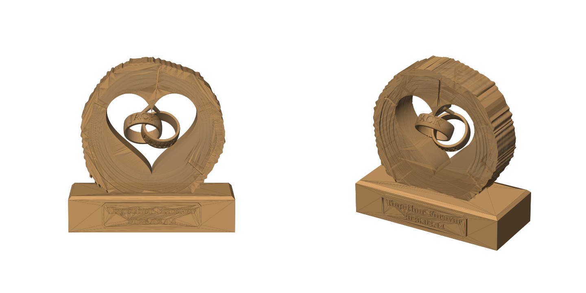
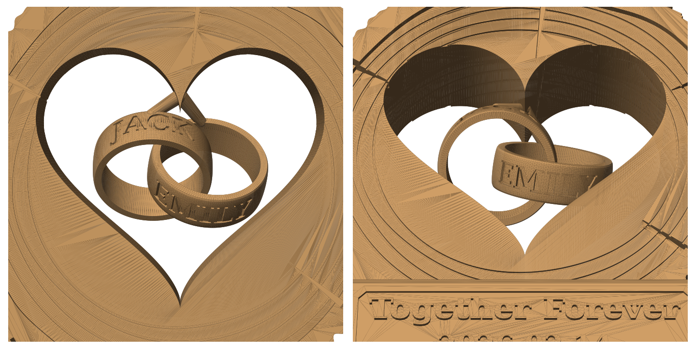

# Coração com alianças — "Together Forever"

Modelo 3D imprimível inspirado na foto: fatia de tronco com casca e coração vazado,
duas alianças entrelaçadas gravadas com nomes, e base com placa e data.

| Ficheiro | Conteúdo |
|---|---|
| `coracao_aliancas_completo.stl` | Peça inteira numa só malha (128 × 58 × 131 mm) |
| `parte1_base_placa.stl` | Só a base com a placa (para imprimir noutra cor) |
| `parte2_tronco_aliancas.stl` | Tronco + alianças (encaixa 3 mm na base; colar) |
| `gerar_stl.py` | Script paramétrico que gera os STL |




## Personalizar nomes / frase / data

```bash
pip install manifold3d trimesh shapely matplotlib numpy scipy
python3 gerar_stl.py "JACK" "EMILY" "Together Forever" "2026.02.14"
```

## Impressão

- Imprimir em pé, assente na base. Escala livre no slicer.
- Ativar suportes (só tocam na construção): por baixo das alianças e no topo do coração.
- As alianças estão entrelaçadas sem se tocar e cada uma está presa ao bico do coração por uma haste fina de ~2,8 mm.
- Sugestão de cores: base em castanho escuro, tronco em PLA "madeira"; pintar a casca e as letras mais escuras.
